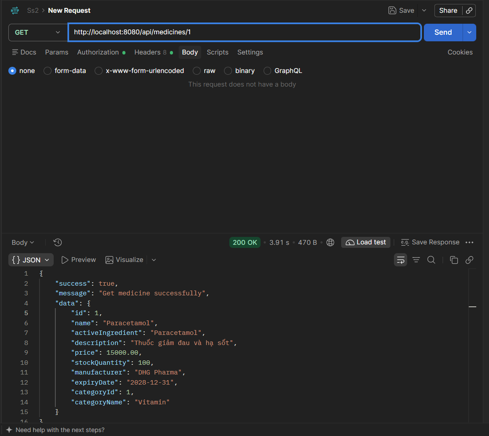
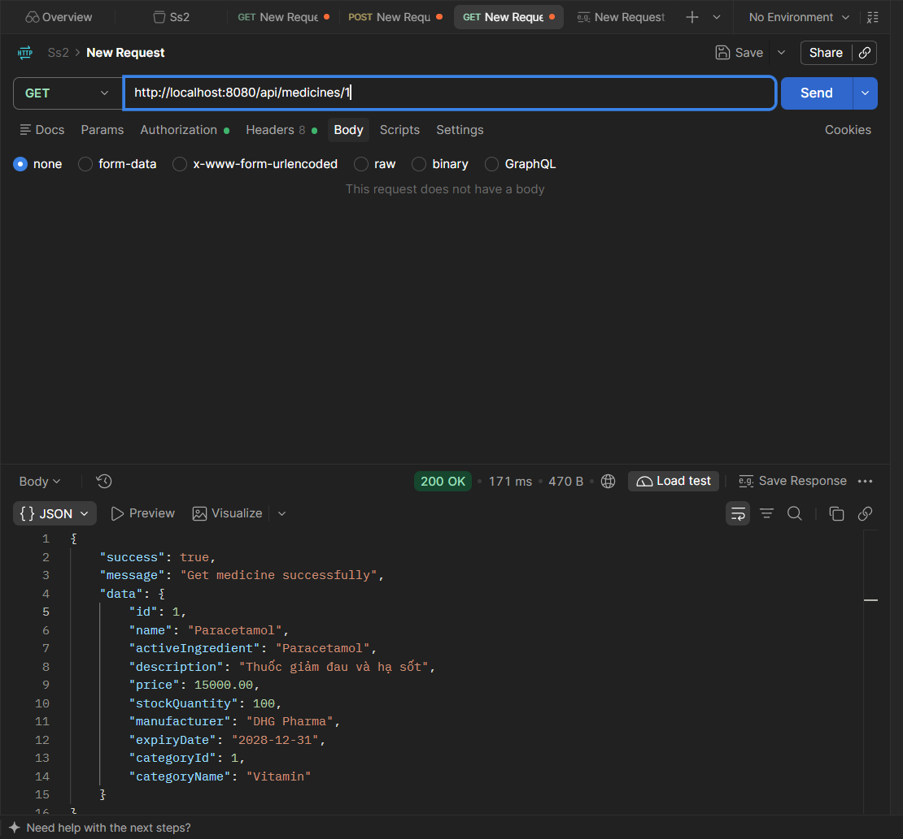
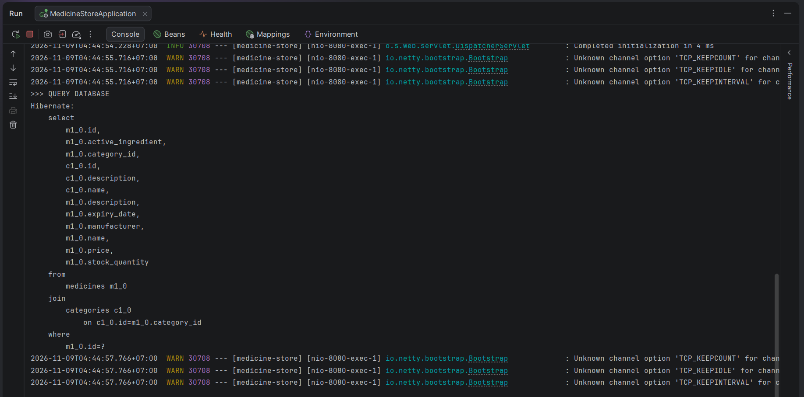

# KIỂM CHỨNG REDIS CACHE
---

## Test lần gọi API thứ nhất

*Chú thích:* Request được gửi khi Redis chưa có key `medicines::1`. Hệ thống thực thi Service để truy vấn PostgreSQL và trả về thông tin thuốc.

## Test lần gọi API thứ hai

**Hình 2. Postman — Lần gọi thứ hai (Cache Hit)**

*Chú thích:* Gửi lại cùng request với ID bằng lần đầu. API vẫn trả về dữ liệu thuốc, nhưng kết quả được lấy từ Redis Cache.

## Kiểm  chứng trên IntelliJ IDEA

**Hình 3. Console IntelliJ IDEA — Kiểm tra truy vấn Database**

*Chú thích:* Trong `getMedicineById()`, dòng log `>>> QUERY DATABASE` được đặt trước câu truy vấn PostgreSQL. Ở lần gọi đầu tiên, dòng log và câu SQL xuất hiện. Ở lần gọi thứ hai, phương thức không chạy lại nên không xuất hiện thêm dòng log này.

**Ý nghĩa của `@Cacheable`:**

- `value = "medicines"`: tên cache được sử dụng.
- `key = "#id"`: sử dụng tham số `id` làm khóa cache.
- Nếu tìm thấy dữ liệu trong cache, Spring trả dữ liệu đó mà không thực thi phương thức.
- Nếu chưa tìm thấy dữ liệu, Spring thực thi phương thức và lưu kết quả trả về vào cache.

## Bảng tổng hợp kết quả kiểm thử

| Tiêu chí | Lần gọi thứ nhất | Lần gọi thứ hai |
|---|---|---|
| Trạng thái cache | Cache Miss | Cache Hit |
| Thực thi phương thức Service | Có | Không |
| Truy vấn PostgreSQL từ phương thức này | Có | Không |
| Lưu kết quả vào Redis | Có | Không cần lưu lại |
| Trả dữ liệu cho API | Có | Có |

## Kết luận

Qua hai lần gọi API `GET /api/medicines/1` với cùng một ID, kết quả kiểm thử cho thấy:

- Ở lần gọi đầu tiên, Redis chưa có dữ liệu nên hệ thống truy vấn PostgreSQL và lưu kết quả vào Redis.
- Ở lần gọi thứ hai, Redis đã có dữ liệu nên Spring trả kết quả từ cache mà không thực thi lại phương thức truy vấn trong Service.
- Cơ chế `@Cacheable` hoạt động đúng với mục tiêu tái sử dụng kết quả đã truy vấn, hạn chế các lần truy vấn Database lặp lại đối với cùng một ID.

**Kết luận:** Redis Cache đã được tích hợp và hoạt động thành công trong chức năng lấy chi tiết thuốc theo ID của dự án Medicine Store.

---

**MEDICINE STORE — REDIS CACHE VERIFICATION**
