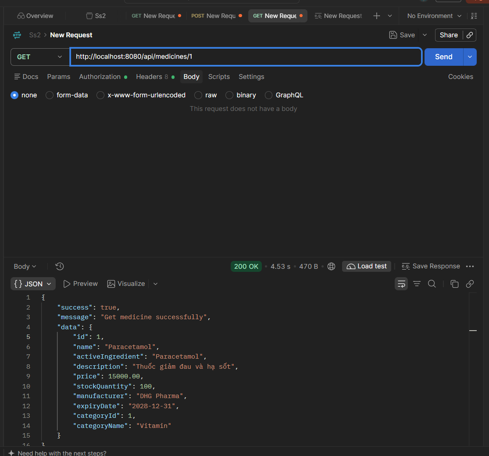
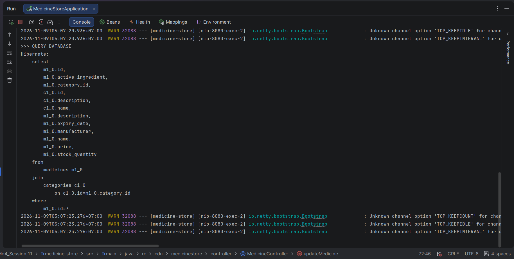
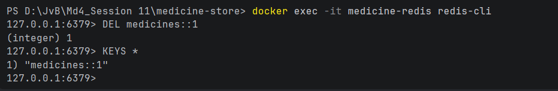
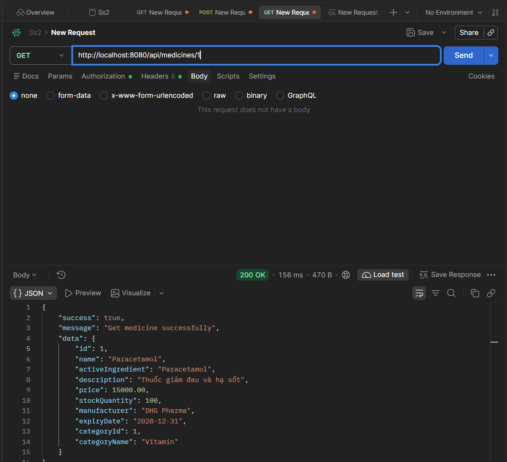
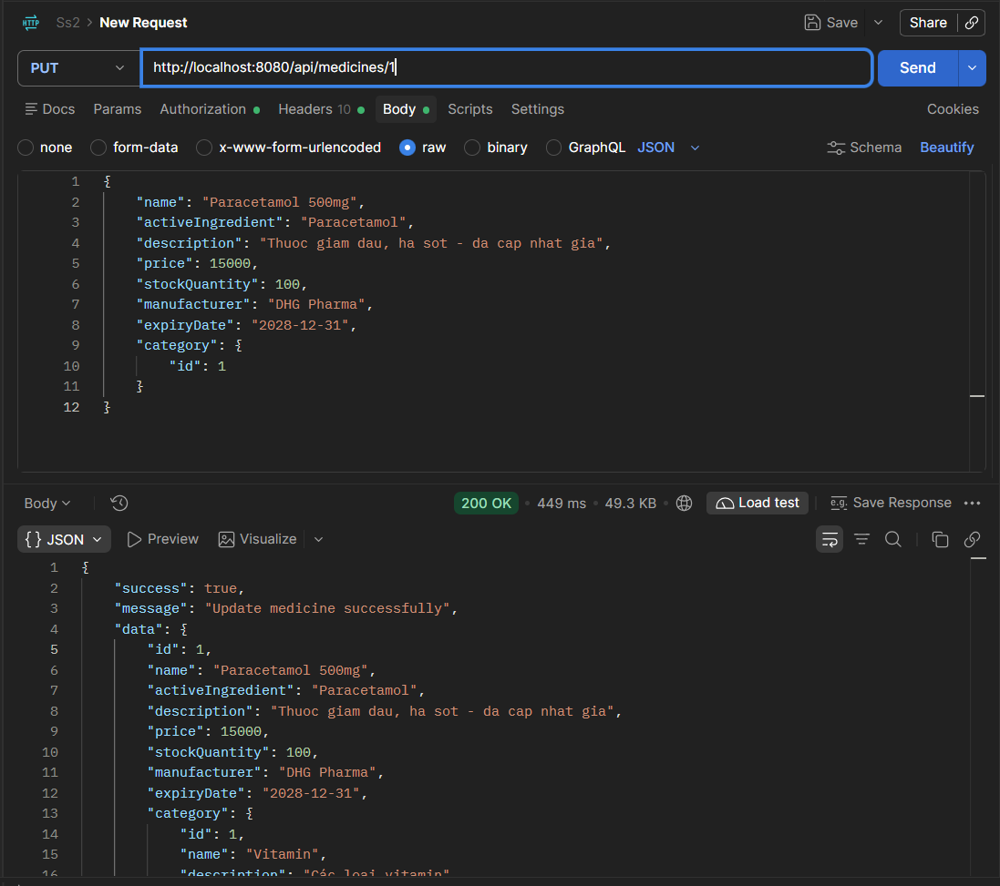

# README – Redis Cache, TTL và Cache Evict trong Medicine Store

## 1. Mục tiêu

Kiểm chứng Redis Cache trong dự án **Medicine Store (Spring Boot + PostgreSQL + Redis)**.

Các nội dung cần chứng minh:

1. Khi gọi API lấy thuốc lần đầu, dữ liệu được truy vấn từ PostgreSQL và lưu vào Redis.
2. Khi gọi lại API với cùng ID, ứng dụng lấy dữ liệu từ Redis Cache, không truy vấn PostgreSQL lần nữa.
3. Cache có thời gian sống (TTL) là **60 phút**.
4. Khi cập nhật thuốc, cache của thuốc tương ứng bị xóa.
5. Khi gọi GET sau khi cập nhật, ứng dụng truy vấn dữ liệu mới từ PostgreSQL và tạo lại cache.
6. API PUT trả về JSON bình thường sau khi xử lý vòng lặp serialize giữa `Medicine` và `Category`.

---

### Bước 1: GET thuốc lần thứ nhất

Gửi request:

```http
GET http://localhost:8080/api/medicines/1
```


**Kết quả:**
- API trả về thông tin thuốc.
- Console xuất hiện:



- Hibernate xuất hiện câu lệnh `SELECT`.
- Redis có key:

Kết quả mong đợi:

```text
(integer) 1
```

### Bước 4: GET thuốc lần thứ hai

Gửi lại đúng request:

```http
GET http://localhost:8080/api/medicines/1
```

**Kết quả:**

- API vẫn trả về thông tin thuốc.
- Không xuất hiện thêm dòng `>>> QUERY DATABASE` cho lần gọi này.
- Không có câu lệnh SELECT mới từ phương thức lấy thuốc theo ID.
- Dữ liệu được trả về từ Redis Cache.

### Bước 5: PUT cập nhật thuốc

Gửi request:

```http
PUT http://localhost:8080/api/medicines/1
Content-Type: application/json
```


**Kết quả:**

- API PUT trả về phản hồi thành công.
- Thông tin thuốc được cập nhật trong PostgreSQL.
- Cache key `medicines::1` bị xóa.

Kiểm tra trong Redis CLI:

```redis
EXISTS medicines::1
```

Kết quả mong đợi:

```text
(integer) 0
```

### Bước 6: GET lại sau khi cập nhật

Gửi lại:

```http
GET http://localhost:8080/api/medicines/1
```

**Kết quả cần quan sát:**

- Console xuất hiện lại `>>> QUERY DATABASE`.
- Hibernate thực hiện SELECT để lấy dữ liệu mới.
- API trả về giá và thông tin vừa cập nhật.
- Redis tạo lại key `medicines::1`.

Kiểm tra:

```redis
EXISTS medicines::1
TTL medicines::1
```

Kết quả mong đợi:

- `EXISTS` trả về `1`.
- `TTL` trả về số giây còn lại, ban đầu xấp xỉ `3600` giây và giảm dần theo thời gian.

---

## 8. Bảng tổng hợp kết quả kiểm chứng

| Thao tác | PostgreSQL | Redis |
|---|---|---|
| GET lần đầu | Có truy vấn SELECT | Tạo key `medicines::1` |
| GET lần thứ hai | Không truy vấn lại từ phương thức cache | Đọc dữ liệu từ cache |
| PUT cập nhật thuốc ID = 1 | Cập nhật dữ liệu | Xóa key `medicines::1` |
| GET sau PUT | Truy vấn SELECT dữ liệu mới | Tạo lại key |

### Kết luận

Qua các bước kiểm chứng, Redis Cache giúp hạn chế truy vấn PostgreSQL khi lấy lại cùng một thuốc theo ID. Cache được cấu hình TTL 60 phút. Khi thuốc được cập nhật, `@CacheEvict` xóa đúng cache key tương ứng để lần GET tiếp theo lấy dữ liệu mới nhất từ PostgreSQL.

Ngoài ra, lỗi serialize JSON do quan hệ hai chiều giữa `Medicine` và `Category` đã được xử lý bằng `@JsonIgnore` ở thuộc tính `Category.medicines`.
